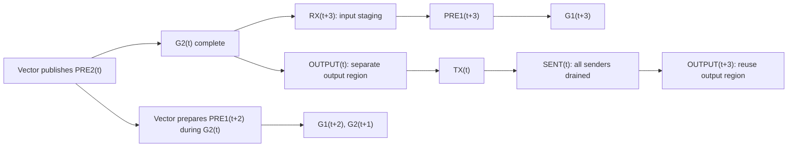

# A3 tile pipeline redesign

## Dependency and buffer ownership

The 2026-10-24 internal trace found little communication overlap in the two-slot
pipeline. Both Cube and Vector look ahead one tile. Reusing slot `t` only after
`TX(t)` therefore creates a steady-state chain:

```text
G2(t) -> OUTPUT(t) -> TX(t) -> RX(t+2) -> PRE1(t+2) -> G1(t+2) -> G2(t+1)
```

The implementation uses three 128-row slots. It retains the existing ordered G1/G2
schedule and seven monotonically increasing stage sequences. The extra credit
lets G1(t+2) proceed while transport refills t+3. Vector publishes PRE2(t),
then prepares G1 input for t+2 while Cube executes G2(t). This lets G1(t+2)
be ready when G2(t) releases the receive credit. Transport refills before sending,
after G2(t) drains. Its writes affect input staging and tile counts only; output
postprocessing reads separate G2 results and zScales. Output reuse still waits for
all old senders. Every producer retains its MTE3/FIX completion fence.



| Region of slot t | Writer reusing it | Required release |
| --- | --- | --- |
| tileX, tileScales, tileCounts | RX(t+3) | G2(t), including all Cube FIX drains |
| G1 workspace | PRE1(t+3) | RX(t+3); old G1 postprocess precedes G2(t) |
| z, zScales, G2 workspace | ACT/PRE2(t+3) | Ordered Vector loop has finished OUTPUT(t) |
| BF16 y | OUTPUT(t+3) | SENT(t), including all transport MTE3 drains |

The G2 wait before refill and SENT wait before output are different ownership
conditions. RECEIVED(t+3) must never be interpreted as SENT(t). Entry/exit remain
the only mixed SyncAll barriers; no subset enters a global barrier.

The Vector loop initially prepares tiles 1 and 2. Each iteration activates the
current tile, publishes PRE2, prepares the tile two positions ahead, then waits
for G2 and writes the current output. Publishing PRE2 before
waiting for the future tile lets Cube continue if that receive is delayed.
Waiting until after output would leave Cube starved during the refill window. Per-stage
sequences remain ordered despite this interleaving.

```text
Cube:      G1(1), G1(2), G2(1), G1(3), G2(2), G1(4), ...
Vector:    PRE1(1), PRE1(2), ACT(1), PRE2(1), PRE1(3), OUT(1), ...
Transport: RX(1..3), wait G2(1), RX(4), wait OUT(1), TX(1), ...
```

## Resource and work partition

The A3 mixed kernel retains 24 AIC and 48 AIV. The original allocation is eight
transport and forty compute AIVs. Screening selected sixteen transport
and thirty-two compute AIVs, within the same physical budget. For a full tile,
transport rows/core change from sixteen to eight; compute rows/core have the same
maximum of four, but all thirty-two cores receive four rows. For a 32-row tile,
all thirty-two compute AIVs have one row instead of eight compute AIVs having no
rows. Smaller tails still have unavoidable row-granularity underutilization.
G1/G2 keep the existing 128/256/256 Matmul API tiling; no arithmetic or reduction
order changes are introduced to improve occupancy.

Each transport AIV fetches the contiguous route segment for the tile/TP source
once. A 256-byte UB index array replaces repeated two-byte route DMA and its
MTE2-to-scalar wait per row. The byte-length route transfer uses the existing non-aligned
[DataCopyPad API](https://www.hiascend.com/doc_center/source/en/CANNCommunityEdition/900/API/ascendcopapi/atlasascendc_api_07_0265.html);
its maximum 256-byte UB footprint includes alignment padding.
Payload writes remain row-partitioned, preserve
expert/TP order and use the original completion fences. The transport UB bound
in host tiling includes the extra 224 bytes. TP intersections can be empty,
partial, or cross a tile boundary; at most 128 route indices are fetched.

Three full slots increase scratch by one slot, independent of chunk capacity.
At H4096/I2048/E32/TP1, it grows from 23,772,672 to 35,570,688 bytes;
the additional slot occupies 11,798,016 bytes (11.25 MiB).
The workspace producer, host tiling and kernel share MegaWorkspace; the Python
extension and custom operator package must be rebuilt together. Existing graph
captures must be recreated with the new allocation.

## Compute and memory budget

| Unit | M / N / K | Data path | Base M / N / K |
| --- | --- | --- | --- |
| G1 | 2r / 2I / H | INT4 ND x NZ, FP16 intermediate in GM | 128 / 256 / up to 256 |
| G2 | 2r / H / I | INT4 ND x NZ, FP16 intermediate in GM | 128 / 256 / up to 256 |

The doubled M dimension is the existing MSD high/low INT4 representation.
Quantization groups can shorten the effective K segment. G1 and G2 share each
AIC sequentially; they do not reserve two simultaneous Cube resource sets.
The Matmul API retains L1/L0 buffering and FIX completion. A 128 x 256 FP32 or
INT32 accumulator occupies the existing 128 KiB L0C budget. The vector stages
retain whole-row quantization and their checked UB bounds, with TPipe reset
between stages. Only transport's private route index buffer grows.

The 16 MiB system workspace, compact-v2 peer windows, stable layer tables and
single/batched FULL graphs retain their existing ownership. No additional
mixed kernel or concurrent compute stream is introduced. Rebuild bindings and
the custom operator together, then recapture graphs; hot swapping a kernel into
an existing two-slot graph allocation is invalid.

## Measurement contract

Keep source and binary identities for every candidate. Use real native Async
CAM DS/MegaMoE/CR with fixed H4096/I2048/E32/top-k2 cases: hot1024, balanced1024,
TP4-hot129 and decode7. Check the analytic numerical oracle and allocation guards
on every iteration. Compare uninstrumented kernels separately from internal
probe runs. Profiles do not qualify model accuracy.

Record RX/TX region intersection with Cube and Vector, per-core WAIT and
PUBLISH time, core start spread and task duration. These code-region spans
through completion fences are not DMA/MAC active cycles. RX stages from the
local HCCL receive window; Attention DS occurs outside this kernel. Clock
alignment is within one NPU die only. Actual checkpoint validation uses the
same 300 GSM8K items, FULL FFN graphs and no new accuracy baseline.

## Validation and results

Final measurements and source/binary identities are recorded in
[validation evidence](ASYNC_CAM_MEGA_MOE_TILE_VALIDATION.json).

The three-slot intermediate still had little direct Cube/communication overlap:
its next PRE1 ran after current output. Moving PRE1 two tiles ahead removes that
remaining dependency. This is an independent, measured scheduling change, with
no extra slot or additional cores.

The original control is the previously profiled, frozen commit `7b3a1d5`
(kernel SHA256 `56fb0aeff46b855097e0e1920d2a05c0c0904ff27b27825a1a9cc35fab986136`).
The pre-existing early-refill working-tree patch was retained. Final kernel:
`fbc03d657ca009c65b1f6073ec4f4d7ffc31b970413c07775e1ebe143130cb2e`.

| Fixed native case | Original mean (us) | Final mean (us) | Time reduction |
| --- | ---: | ---: | ---: |
| hot1024 | 2171.39 | 959.49 | 55.81% |
| balanced1024 | 2466.01 | 1285.88 | 47.86% |
| TP4-hot129 | 1275.53 | 660.76 | 48.20% |
| decode7 | 815.49 | 540.07 | 33.77% |

These use four original controls and two final repetitions. Each measurement is
the largest FFN-rank mean over the last five of twelve calls after one warmup.
All calls check an analytic oracle and allocation guard. Synthetic diagonal
weights exercise the native operators; this table is not a model benchmark.

In the balanced case, direct Cube/communication stage intersection changes from
0 to 149.86 us on FFN rank 1 and 200.28 us on rank 2. Total communication/compute
stage overlap is 93.07% / 93.52%; Cube covers most of those communication windows.
These are code regions through existing fences, not hardware-active percentages.
The raw `aic_mac_ratio` PMU field in hot1024 increases from 0.0754 to 0.1708,
measured independently of the phase-window intersections.
The full 72-core traces include separate WAIT, DRAIN and PUBLISH intervals. The average
stage WAIT across all 24 Cube cores decreases as follows; publication overhead
is recorded separately and is not counted as useful compute.

| Case / FFN rank | Original Cube wait (us/core) | Final Cube wait (us/core) | Reduction |
| --- | ---: | ---: | ---: |
| hot1024 / 1 | 1443.86 | 266.76 | 81.52% |
| balanced1024 / 1 | 1614.09 | 511.17 | 68.33% |
| balanced1024 / 2 | 1662.48 | 445.63 | 73.19% |
| tp4hot129 / 4 | 859.71 | 214.04 | 75.10% |

The final kernel passes 25 native interface/graph pytest cases, four distributed
eager/FULL finite cases, and a TP4 test with varying values per token. The latter
checks cross-TP tile slices with an analytic oracle. The local regression suite
passes 596 tests and 33 subtests, with 184 hardware/dependency skips. Changed-file
pre-commit passes.

On `afd-mrv2-async`, FULL FFN graphs pass the same 300 GSM8K documents and prompts:
287/300 (95.67%) in both strict and flexible extraction. Against the frozen
283/300 run, five documents improve and one worsens; 171 generated texts differ.
This qualifies aggregate accuracy, not bitwise output equivalence or a causal
accuracy improvement. No fresh model accuracy baseline was run.

A separate diagnostic run captures 24 actual-checkpoint transactions across all
eight FFN ranks, after a client gate excludes startup warmup. It uses a 256-input /
64-output request and twelve concurrent 128-input / 16-output requests. Public
scratch views retain their ABI shape; owning storage adds trace tails and guards.
Across original, intermediate and final variants, the native/model captures pass
74,864 ordering and buffer-ownership checks. The 132 operator-view JSON files
pass schema, finite-duration and 4,074 dependency-flow checks. Sixty native
probe envelopes agree with the 50 MHz conversion against CANN task durations
to within 2.5%; clocks remain independent across dies.
The final source and native artifact hashes match after accuracy evaluation.
In the final real-checkpoint dense captures, communication/compute stage overlap
is 61.46%–89.81%, and direct Cube/communication stage overlap is 38.45%–80.56%.
One-tile captures have zero inter-tile overlap, as expected.

## Boundaries

The controlled cases and the real checkpoint run use one A3 node. Native kernel
timing does not establish cross-host latency or end-to-end model throughput.
Software code-region intersections are upper bounds on hardware-active overlap.
Tiny one-tile transactions have no later tile to overlap. Small M/N grids can
still leave Cube cores without a matrix block; this change preserves the Matmul
split and numerical operations rather than adding Split-K or a new reduction.
